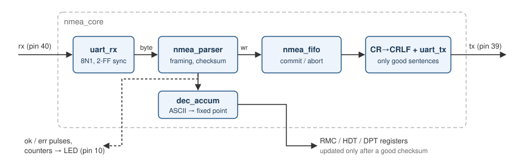

# NMEA0183 checksum filter & decoder on FPGA

[](../../actions/workflows/ci.yml)

A SystemVerilog NMEA0183 receiver for the **Sipeed Tang Nano 4K** (Gowin GW1NSR-4C).

It listens to a marine NMEA0183 line (GPS, gyro, echo sounder, ...), checks every
sentence, **repeats only the sentences with a correct checksum** and decodes a few of
them into binary registers that other logic can use (e.g. an HDMI or LCD display).



## Features

- 8N1 UART receiver with input synchronizer and start-bit glitch filter
- Byte-by-byte parser: `$`/`!` start, XOR checksum, `*hh`, CR / LF / CRLF endings,
  82-character limit, restart on a new `$` in the middle of a sentence
- Error reporting per sentence: checksum, bad hex, missing checksum, too long,
  missing line end, restart
- Commit/abort FIFO: bytes are stored while the sentence arrives and are released
  to the output only when the checksum is good, otherwise they are thrown away
- Output always ends with CR LF, output baud can be different from input baud
- Decoded fields (talker ID is ignored, so `GP`, `GN`, `HE`, `SD`, `II` all work):

  | Sentence | Output | Units |
  |---|---|---|
  | RMC | `rmc_utc` | hhmmss as decimal (123519) |
  | RMC | `rmc_fix` | status `A` |
  | RMC | `rmc_lat`, `rmc_lat_s` | ddmm.mmmm × 10⁴, 1 = South |
  | RMC | `rmc_lon`, `rmc_lon_w` | dddmm.mmmm × 10⁴, 1 = West |
  | RMC | `rmc_sog`, `rmc_cog` | knots × 10, degrees × 10 |
  | HDT | `hdt_heading` | degrees × 10 |
  | DPT | `dpt_depth` | metres × 10 |

  Values are updated only when the whole sentence passes the checksum.
- Counters for good sentences, bad sentences, FIFO overflows and UART framing errors

## Repository layout

```
rtl/      synthesizable SystemVerilog
  nmea_pkg.sv      constants, error / message types
  uart_rx.sv       UART receiver
  uart_tx.sv       UART transmitter
  dec_accum.sv     ASCII decimal field -> fixed point
  nmea_parser.sv   framing, checksum, field decoding
  nmea_fifo.sv     FIFO with commit / abort
  nmea_core.sv     everything connected
fpga/     Tang Nano 4K top, pin constraints, Gowin EDA and open source build
tb/       testbench: generator, reference model, scoreboard, assertions
sim/      Makefile for Verilator
docs/     block diagram
```

## Simulation

Needs Verilator 5.x (`sudo apt install verilator` on Ubuntu 24.04).

```sh
cd sim
make            # lint + random test (2000 sentences)
make test_ovf   # slow output + small FIFO, checks that overflow is handled
make regress    # 8 different seeds
make wave       # short run with tb.vcd for GTKWave
SEED=7 N=5000 ERR=50 make test
```

Example output:

```
---- functional coverage ----
  messages   OTHER=484 RMC=517 HDT=472 DPT=527
  terminator CRLF=649 LF=681 CR=670
  lat decimals 0..5: 67 93 66 87 80 67
  RMC with empty position: 57
  inject INJ_NONE       1405
  inject INJ_FLIP_CHAR  82
  ...
---- result ----
  good 1407  bad 595  repeated 1407  dropped(ovf) 0
TEST PASSED
```

### How it is verified

- **Random stimulus**: a generator class makes RMC, HDT, DPT, GGA, MWV and AIVDM
  sentences with random values, random number of decimals, empty fields and random
  line endings. The UART bit time is changed by ±2 % per sentence, random idle gaps
  and noise bytes are added between sentences.
- **Error injection** (30 % by default): flipped character, wrong checksum, non hex
  checksum, missing checksum, truncated sentence, too long sentence, garbage after
  the checksum.
- **Reference model**: the expected values are calculated in the testbench from the
  text (independent from the RTL) and compared on every update.
- **Scoreboards**: status (ok / error code / message type) per sentence, decoded
  values, the exact text repeated on tx, final counters.
- **Assertions** (SVA, attached with `bind`, see `tb/nmea_sva.sv`): ok and error
  never together, commit only with ok, updates only after a good checksum, FIFO
  pointer order, idle UART line is high, length limit.
- **Functional coverage**: every message type, line ending, injected error and
  number of decimals must be hit, otherwise the test fails.
- The testbench was checked against deliberately broken RTL (no checksum check,
  no padding in the decimal conversion, FIFO abort that does nothing, no length
  check, UART sampling at the wrong time); every one of them makes the test fail.

## Tang Nano 4K

| Signal | Pin | Note |
|---|---|---|
| `clk_27m` | 45 | 27 MHz oscillator |
| `key_n` | 15 | button, reset |
| `nmea_rx` | 40 | 3.3 V TTL input |
| `nmea_tx` | 39 | 3.3 V TTL output, good sentences only |
| `led` | 10 | short flash = good sentence, long = error |

> ⚠️ NMEA0183 is RS-422. **Do not connect the ship's lines directly to the FPGA.**
> Use an RS-422/RS-485 receiver (MAX3485, SN65HVD...) or an opto-coupler between the
> NMEA talker and pin 40, and an RS-422 driver after pin 39 if the output goes to
> other equipment.

Default speed is 4800 baud in and out (change `BAUD_IN` / `BAUD_OUT` in
`fpga/tang_nano_4k_top.sv`, e.g. 38400 for AIS). If the LED is on all the time
instead of flashing, change `LED_LOW`.

### Build with Gowin EDA

GUI: new project, device `GW1NSR-LV4CQN48PC7/I6` (some boards have `PC6/I5`),
add all files from `rtl/` and `fpga/` (`.sv`, `.cst`, `.sdc`), set top module
`tang_nano_4k_top`, *Project → Configuration → Synthesize → Verilog Language:
SystemVerilog 2017*, then Run All and program with the Programmer.

Command line:

```sh
cd fpga
gw_sh build_gowin.tcl
```

### Build with open source tools

```sh
pip install yowasp-yosys yowasp-nextpnr-himbaechel-gowin apycula
# sv2v from https://github.com/zachjs/sv2v/releases
cd fpga
make YOSYS=yowasp-yosys NEXTPNR=yowasp-nextpnr-himbaechel-gowin
make load       # openFPGALoader
```

The CI builds this bitstream on every push and keeps it as an artifact.

### Resources (nextpnr, GW1NSR-4C)

| | Used | Available |
|---|---|---|
| LUT4 | 475 | 4608 |
| DFF | 167 | 3456 |
| BSRAM | 1 | 10 |
| Fmax | ~120–170 MHz | 27 MHz needed |

The decoded registers are not connected to pins yet, so the tools remove that part
in this build. The whole `nmea_core` with all outputs stays under 1000 LUTs.

## Next steps

- Show heading, position and depth on HDMI (the Tang Nano 4K has an HDMI port)
- More sentences: GGA, VTG, MWV (wind), VHW
- Several NMEA inputs merged into one output (multiplexer)
- Formal proof of the FIFO with SymbiYosys

## Author

George Kostopoulos — electronics / marine telemetry.
Developed with AI assistance.

## License

MIT, see [LICENSE](LICENSE).
